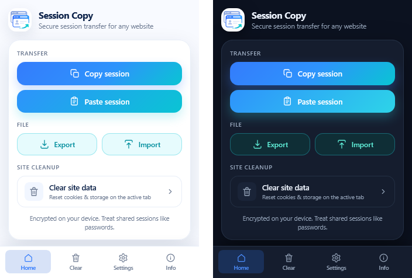

<p align="center">
  
</p>

<h1 align="center">Session Copy for Firefox</h1>

<p align="center">
  Copy and restore encrypted login sessions for any website — Firefox Manifest V3 port of
  <a href="https://github.com/Makogai/session-copy">Makogai/session-copy</a>.
</p>

<p align="center">
  <a href="LICENSE"></a>
  
  
</p>

---

Session Copy captures the **cookies (including HttpOnly)**, **localStorage**, and **sessionStorage** of the active tab's site, encrypts them on the device (AES-256-GCM), and exports the result as a clipboard token or an encrypted `.session` file. Importing it in another browser opens the site with the session applied. There is no backend, account, or telemetry.

The token (`sc:v2:…`) and `.session` formats are identical to the Chrome version, so sessions can be moved between Chrome and Firefox in either direction.

<p align="center">
  
</p>

## Features

- **Copy / Paste** an encrypted session through the clipboard.
- **Export / Import** an encrypted `.session` file (used automatically for large sessions).
- **Login transfer mode** (default) — copies only authentication-related cookies and storage keys. Full sync is available in Settings.
- **Container tabs and private windows** — sessions are read from and restored into the active tab's own cookie store.
- **Clear site data** — removes cookies, localStorage, and sessionStorage for the active site.
- Light, dark, and system themes.

## Installation

### Build from source

Requires Node.js 20 or later.

```bash
git clone https://github.com/itinfra7/session-copy-firefox.git
cd session-copy-firefox
npm install
npm run build
```

### Load temporarily (development)

1. Open `about:debugging#/runtime/this-firefox`.
2. Click **Load Temporary Add-on…** and select `dist/manifest.json`.

The add-on stays loaded until Firefox restarts. `npm run start` launches a separate Firefox profile with the add-on loaded and auto-reloaded.

### Install permanently

Release and ESR builds of Firefox only install add-ons signed by Mozilla. Sign an unlisted build with your [AMO API credentials](https://addons.mozilla.org/developers/addon/api/key/):

```bash
export WEB_EXT_API_KEY="user:00000000:000"
export WEB_EXT_API_SECRET="..."
npm run build:release
npm run sign
```

The signed `.xpi` is written to `release/`; open it in Firefox to install. The add-on ID is `session-copy-firefox@itinfra7`; forks that sign their own builds must use a different ID.

Firefox Developer Edition and Nightly can install the unsigned package from `npm run package` when `xpinstall.signatures.required` is set to `false` in `about:config`.

## Usage

1. Sign in to a website, then open the Session Copy popup on that tab.
2. Click **Copy session** (or **Export** to save a `.session` file).
3. In the target browser, click **Paste session** (or **Import** and choose the file).
4. The site opens in a new tab in the same window and container, with the session applied, and reloads once.
5. If a restore leaves the site in a broken state, use **Clear** to reset its cookies and storage.

To use the add-on in private windows, enable **Run in Private Windows** in `about:addons` → Session Copy.

> A copied token or exported file is a bearer credential. Anyone who has it can use the session until it expires or is revoked by the site.

## Differences from the Chrome version

| Area | Chrome version | Firefox version |
|------|----------------|-----------------|
| Background | Service worker | Event page (`background.scripts`) |
| Extension API | `chrome.*` | `browser.*` (promise-based) |
| Cookie store | Default store only | Active tab's `cookieStoreId` (containers, private windows) |
| Import | File picker inside the popup | Dedicated tab with file picker and drag-and-drop (Firefox closes the popup when a file picker opens) |
| Host access | Granted at install | Revocable in `about:addons`; the popup offers to re-grant it |
| Restore sequence | Cookies applied while the page loads | Cookies applied before the first request, re-applied after load, then storage injection and reload |
| Content scripts | Two scripts on every page | None |
| Host-only cookies | Restored as domain cookies | Restored as host-only (optional `hostOnly` field, ignored by the Chrome version) |
| `sameSite` | Includes `unspecified` | Only values Firefox accepts (`no_restriction`, `lax`, `strict`) |

## Development

| Command | Description |
|---------|-------------|
| `npm run build` | Development build into `dist/` (with source maps) |
| `npm run dev` | Watch mode |
| `npm run start` | Run Firefox with the add-on via `web-ext run` |
| `npm run lint` | Validate `dist/` with `web-ext lint` (AMO linter) |
| `npm run typecheck` | Type-check the Vue/TypeScript UI |
| `npm run package` | Release build, lint, and `release/session-copy-firefox-v<version>.zip` |
| `npm run sign` | Sign an unlisted build through AMO |
| `npm test` | Unit tests |
| `npm run test:e2e` | End-to-end tests in Firefox |

Project layout:

```
src/background.js     restore flow (event page)
src/core/             capture, cookie apply/query, pack/encrypt, site cleanup
src/utils/            crypto helpers and capture filters
src/popup/            toolbar popup (Vue 3 + TypeScript)
src/import/           import page
tests/unit/           node:test suites and Chrome-generated fixtures
tests/e2e/            Selenium runner and local test site
tests/harness/        test-only extension page (built into dist-test only)
```

### Tests

- **Unit** — token and file round-trips, decoding of tokens and files produced by the Chrome version, and cookie restore rules (`__Host-`, host-only, `sameSite`, target cookie store).
- **End-to-end** — launches the installed Firefox with a fresh temporary profile, installs a test build, and verifies capture, clipboard, file export, site cleanup, restore against a local site (including the HttpOnly session cookie reaching the server), container isolation, and popup/import rendering. Set `HEADED=1` to show the browser window. If Firefox has a downloaded update pending, launching it applies that update.

## Limitations

- IndexedDB, Cache Storage, and service worker caches are not exported.
- Cookie restore may fail when first-party isolation (`privacy.firstparty.isolate`) is enabled.
- Partitioned (CHIPS) cookies are not captured.
- Sites that bind sessions to a device, IP address, or IndexedDB state may only be partially restored.
- Firefox for Android is not supported.

## Privacy

All processing happens locally. See [PRIVACY.md](PRIVACY.md) for details and the permissions used.

## Credits

- **Firefox port:** [itinfra7](https://github.com/itinfra7)
- **Original project:** [Session Copy](https://github.com/Makogai/session-copy) by [Makogai](https://github.com/Makogai), MIT License, Copyright (c) 2021 Lawrence Lagerlof
- **Design tokens and popup styles:** [@makogai/extension-brand](https://www.npmjs.com/package/@makogai/extension-brand) (MIT)
- Icons and logo from the original project.

This port is independent and is not affiliated with or endorsed by the original author.

## License

[MIT](LICENSE). The original copyright notice is retained alongside the notice for the Firefox port.
